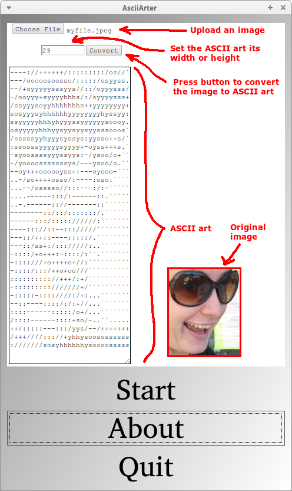
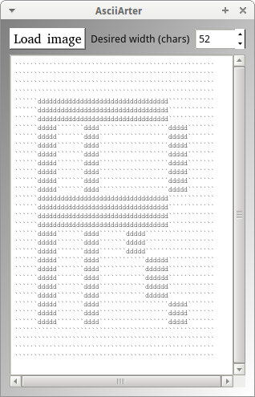
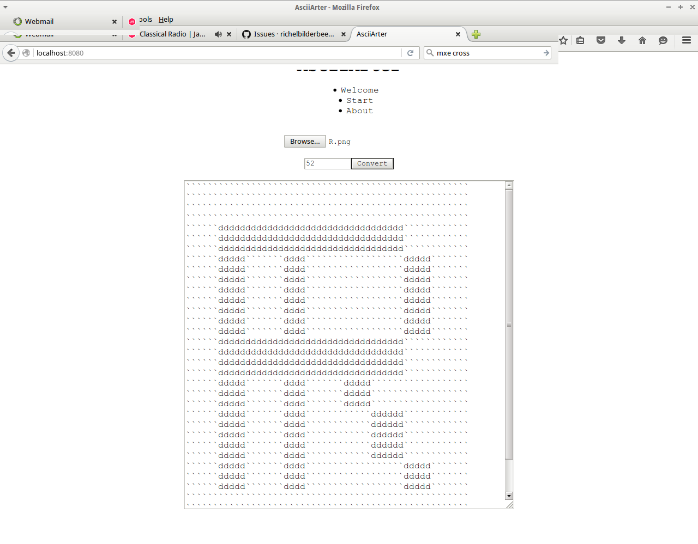

# AsciiArter

AsciiArter is a C++ tool to create ASCII art
and one of [Richèl Bilderbeek's tools](https://richelbilderbeek.github.io/games).

## Links

- [AsciiArter GitHub repository](https://github.com/richelbilderbeek/AsciiArter)
